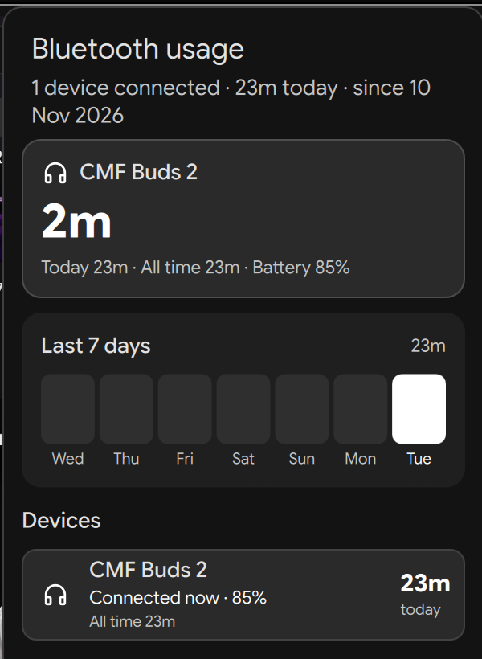

# Bluetooth Usage

[](https://github.com/duxlabs-dev/dux-shell)
[](LICENSE)
[](#requirements)

Track how long your Bluetooth audio devices are **connected**, how long they are
**actually playing audio**, and how much time they spend **connected but idle**.

Built for TWS earbuds, headsets and Bluetooth speakers in
[DankMaterialShell](https://github.com/duxlabs-dev/dux-shell).

<p align="center">
  
</p>

## Why

A pair of earbuds can sit connected for six hours while only playing music for
forty minutes. A simple "connected time" counter does not tell you how much you
actually listened. This plugin tracks both, so you can see the difference at a
glance.

## Features

- **Live connected time** in the DankBar, with a listening indicator when audio
  is playing (`34m · 4s 75%`) or `idle` when it is not (`34m · idle 75%`).
- **Separate listening timeline**, detected from the active PipeWire/PulseAudio
  stream routed to the Bluetooth sink. Paused media does not count.
- **Idle time** for the connected-but-not-playing portion.
- **Popout details**: live session, today, all-time, last session and battery for
  each device.
- **Dual 7-day chart**: total connected time with the listening portion filled in.
- **Weekly summary notification** with connected, listening and idle time plus
  your top device. Configurable day and time.
- **Per-device history**: multiple headsets, earbuds and speakers are tracked
  separately.
- **Restart-safe**: active sessions survive DMS restarts; data survives reboots.
- **Reconnect grace period**: short A2DP/HFP dropouts are merged into one session.
- **Local only**: no account, network calls, telemetry or cloud sync.

## Requirements

- DankMaterialShell **2.1.0 or newer**
- BlueZ (already used by DMS)
- PipeWire or PulseAudio with `pactl` available
- `dms` CLI (installed with DMS)

The weekly summary uses the built-in `dms notify`, so `notify-send` is not
required.

## Installation

### From the DMS plugin registry

Once the registry submission is merged:

```bash
dms plugins install bluetoothUsage
```

Then enable it in **Settings → Plugins → Bluetooth Usage**.

### Manual installation

```bash
git clone https://github.com/Rythamo8055/dms-bluetooth-usage.git \
  ~/dms-bluetooth-usage

ln -s ~/dms-bluetooth-usage ~/.config/dms/plugins/bluetoothUsage

dms ipc call plugin-scan scan
```

Enable **Bluetooth Usage** in **Settings → Plugins**, then add the widget from
**Settings → Bar → Widgets**.

If it does not appear immediately, restart the shell:

```bash
systemctl --user restart dms
```

## Settings

| Setting | Default | Description |
| --- | --- | --- |
| Track all Bluetooth devices | Off | Track every device instead of only headsets and speakers. |
| Show battery percentage | On | Show the battery level reported by BlueZ. |
| Show listening time in the bar | On | Show live listening time or `idle` next to the connected time. |
| Hide while disconnected | Off | Hide the bar widget when nothing is connected. |
| Notify on connect | Off | DMS toast when a tracked session starts. |
| Notify on disconnect | Off | DMS toast with the finished session duration. |
| Reconnect grace period | 45 s | Merge short profile-switch dropouts into one session. |
| Weekly summary | On | Send a weekly summary notification. |
| Summary day / time | Monday 09:00 | Local time for the weekly notification. |
| Send weekly summary now | — | Send a summary immediately. |

## How it works

The plugin has two surfaces:

- **Daemon** (`BluetoothUsageDaemon.qml`) watches `BluetoothService` every two
  seconds for connect/disconnect changes and records sessions. It samples
  `pactl -f json list` to detect whether an uncorked, unmuted stream is routed to
  the device's Bluetooth sink.
- **Widget** (`BluetoothUsageWidget.qml`) reads the local state file and adds the
  currently running session on top for live display. The popout is in
  `BluetoothUsagePopout.qml`, settings in `BluetoothUsageSettings.qml`.

Connected, listening and idle time all use the same session/day buckets, so they
stay consistent across midnight and restarts. A heartbeat lets the daemon recover
the correct end time after a crash or power loss.

## Data

All data is stored locally at:

```text
~/.local/state/dms/bluetooth-usage.json
```

The file keeps up to three months of daily history and the last 60 sessions per
device. It is plain JSON and safe to back up. The plugin makes no network
requests.

## IPC

```bash
dms ipc call btUsage status    # JSON: sessions, today, connected/listening/idle
dms ipc call btUsage today     # today's connected seconds
dms ipc call btUsage preview   # print the weekly summary text
dms ipc call btUsage summary   # send the weekly summary now
dms ipc call btUsage clear     # wipe all statistics
```

`status` includes per-device `sessionSeconds`, `playingSessionSeconds`,
`todaySeconds`, `playingTodaySeconds`, `idleTodaySeconds`, `totalSeconds`,
`playingTotalSeconds` and `idleTotalSeconds`.

## Compatibility

- **Compositor:** any (DMS owns the UI; tested on niri)
- **Distro:** any (tested on Fedora 45)
- **DMS:** 2.1.0+
- **Audio backend:** PipeWire or PulseAudio with `pactl`

## Notes and limitations

- BlueZ does not keep a connection history, so tracking starts when the plugin is
  first enabled. Earlier usage cannot be reconstructed.
- "Listening" means an uncorked, unmuted stream is routed to the device's
  Bluetooth sink. A stream that outputs silence still counts as listening.
- Sessions shorter than the two-second poll interval are not recorded.
- Battery levels are whatever BlueZ exposes; some TWS earbuds report only one
  side or nothing at all.
- The weekly summary is delivered through the DMS notification daemon and stays
  in notification history.

## Uninstall

```bash
dms plugins disable bluetoothUsage
rm ~/.config/dms/plugins/bluetoothUsage
```

Remove the widget from **Settings → Bar → Widgets** first if you added it. The
state file can be deleted manually if you also want to erase the history.

## License

MIT — see [LICENSE](LICENSE).
